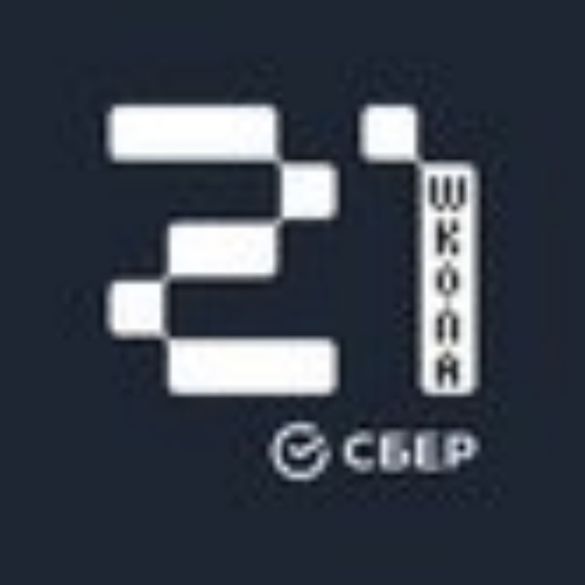
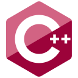

<h1 align="center">Ярослав · @YaroslavEvg</h1>

<strong>Разработка · DevOps · Учебные проекты</strong>

  <a href="#проекты">Проекты</a> ·
  <a href="#навыки">Навыки</a> ·
  <a href="#технологический-стек">Технологический стек</a> ·
  <a href="#образование">Образование</a> ·
  <a href="#контакты-и-каналы">Контакты и каналы</a>

## Проекты

### Поиск по AI-Disrupt PDLC и PSLC

Новый независимый учебный RAG-проект для поиска по руководствам о разработке и сопровождении цифровых продуктов. Для выбранных тем доступны ответы по авторским заметкам со ссылками на страницы оригиналов.

**Открыть проект** · [pdlc.yaroslavevg.ru](https://pdlc.yaroslavevg.ru/) · [pslc.yaroslavevg.ru](https://pslc.yaroslavevg.ru/)

### Другие проекты

-  [desperos.ru](https://desperos.ru)
-  [MonitorinRF](https://t.me/MonitorinRF)

## Навыки

### Школа 21

### Языки в репозиториях GitHub

## Технологический стек

**Языки, фреймворки и библиотеки**

  
  
  
  
  
  
  

**Инфраструктура и мониторинг**

  
  
  
  
  
  
  
  
  

**Инструменты и документация**

  
  
  
  
  

## Образование

 [Сертификат Школы 21](Certificate%20School21%20eduacation.pdf)

## Контакты и каналы

-  [Telegram · @YaroslavEvg](https://t.me/yaroslavevg)
-  [LinkedIn · YaroslavEvg](https://www.linkedin.com/in/yaroslavevg)
-  **SkillTechArena** · [Telegram](https://t.me/SkillTechArena) · [MAX](https://max.ru/join/jWb8V4IKqeHRzQQbR7g9M3z2njiCoicvB9S5ZZaaUxU)
-  [S21_MSK_Events в Telegram](https://t.me/S21_MSK_Events)

---

**Рекомендация по хостингу**

